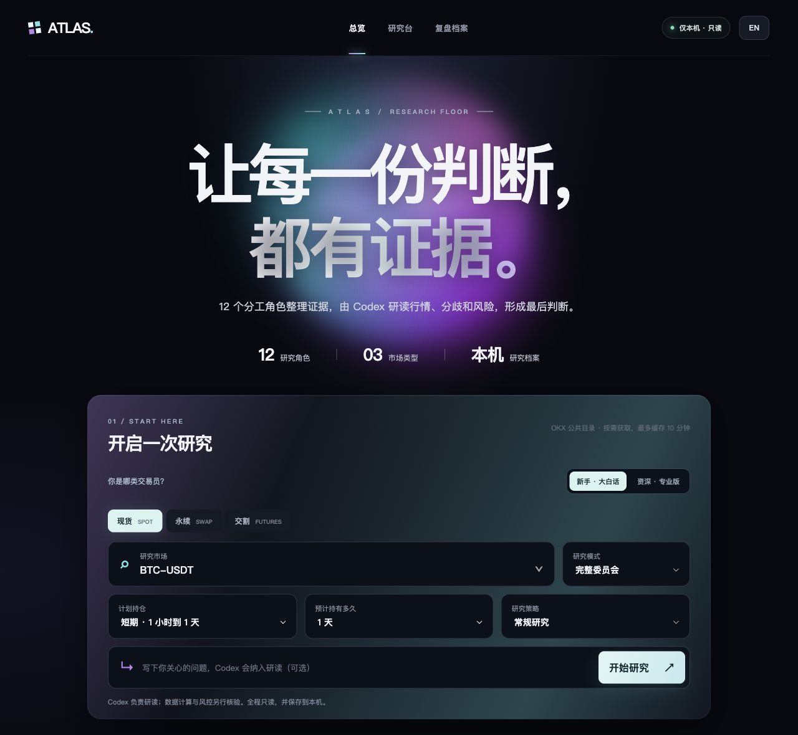
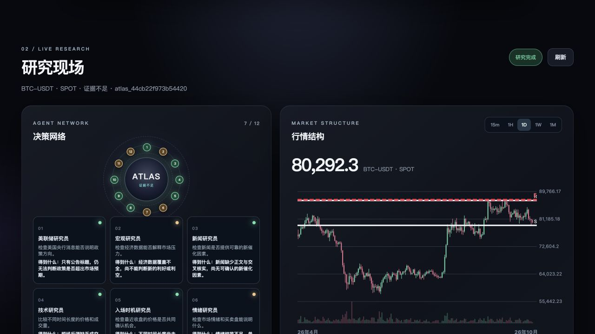
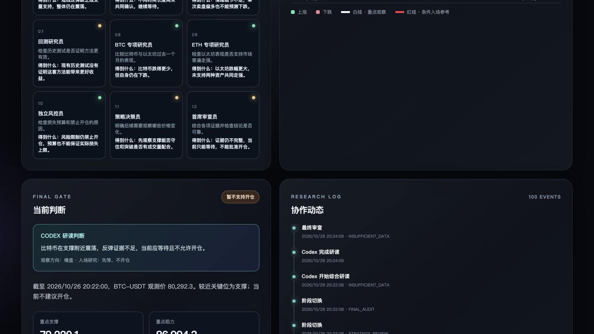

# ATLAS — Institutional Trading Intelligence


[简体中文](README.md) · [English](README_EN.md)

An independent crypto research Skill and local dashboard. It brings OKX public market data, assigned research roles, Codex evidence review, risk checks, and local records into a reviewable workflow. This release cannot place real orders. “Institutional” describes the workflow; it does not imply endorsement by OKX, the Federal Reserve, or any financial institution. No return or win-rate improvement is promised.


*Concept artwork; it does not show live prices or trading signals.*

## Home and research dashboard

The home screen lets you choose novice or experienced explanations, spot/swap/expiry markets, a planned holding period, and a research mode. Market conclusions appear only after a research run.



The research dashboard shows evidence progress, price charts, Codex findings, and risk results.





The two research screenshots show an archived BTC-USDT snapshot. Its price and conclusions apply only to the time shown; run a new study for a current view.

## Install

Python 3.11+ is required. From this project directory:

```bash
python -m venv .venv
# macOS / Linux
.venv/bin/python -m pip install '.[dev,mcp]'
.venv/bin/atlas doctor
.venv/bin/atlas ui
.venv/bin/atlas research ETH-USDT-SWAP --mode full --timeframes 15m,1H,1D,1W,1M
```

On Windows, use `.venv\Scripts\python.exe` and `.venv\Scripts\atlas.exe`. Runtime-only installation uses `.`; `dev` adds development checks and `mcp` adds the optional protocol server.

`.venv/bin/python scripts/install.py` creates a user-space runtime environment and copies the discoverable Skill to `~/.codex/skills/atlas-institutional-research`. Use any verified Python 3.11+ executable if that development venv is absent; the macOS `python3` command may point to an older release. The installer excludes developer virtual environments, secrets and research records. `--runtime-python PATH` reuses a prepared runtime; `--skill-only` only copies source. See [installation](docs/installation.md).

## Commands and natural language

```bash
atlas doctor
atlas ui
atlas init --language en --capital-usdt 300 --markets BTC-USDT,ETH-USDT --no-open-positions
atlas research BTC-USDT --mode quick
atlas research ETH-USDT-SWAP --mode full --timeframes 15m,1H,1D,1W,1M
atlas research BTC-USDT --mode full --lang zh
atlas research ETH-USDT-SWAP --mode full --lang en
atlas reassess PREVIOUS_RESEARCH_ID
atlas event-study --asset BTC-USDT --event FOMC
atlas backtest --asset ETH-USDT-SWAP
atlas history
atlas history show RESEARCH_ID
atlas audit RESEARCH_ID
atlas export RESEARCH_ID --format markdown
atlas config show
atlas capabilities --refresh
atlas mcp
```

Ask a compatible agent to “open the ATLAS dashboard”, “use ATLAS to research ETH across daily, weekly and monthly trends”, “study BTC after FOMC events”, “audit the last report”, or “show local research history”. The local dashboard fetches and briefly caches the OKX public spot/swap/expiry catalog, then shows role progress, charts, risk decisions, bilingual reports, and local research records. A completed dashboard run requires a Codex CLI evidence review; one review covers the role questions and is not twelve independent model agents. See [visual dashboard](docs/visual-dashboard.md). Simple ticker requests should use lightweight market data. Installed `--help` is authoritative for arguments.

## Execution and truthfulness

The coordinator schedules twelve roles: macro, Fed, news, technical, entry timing, sentiment, historical/backtest, BTC specialist, ETH specialist, independent risk control, strategy and chief review. The specialists use aligned confirmed UTC daily BTC/ETH bars of matching market and quote type to describe relative returns, realized volatility and drawdown. The risk officer reports price freshness, support/resistance, exposure, capital budget, exchange constraints and entry veto to strategy and chief review. Validated structured results, evidence references, messages, revisions and review issues share a Research ID. Bounded rework does not require finding a trade.

`--engine codex` is the default and requires a completed read-only Codex evidence review. `--engine deterministic` is an explicit diagnostic mode for numerical analysis without an external model. `--engine host` exposes tasks for real host-managed independent agents and accepts `atlas submit` JSON. `--engine llm` uses an explicitly configured compatible provider. Reports identify the mode accurately; deterministic roles are not claimed as separate LLM researchers.

Verified OKX CLI, configured read-only MCP bridge and official public REST are prioritized. Missing private news, consensus expectations, macro vintages or licensed positioning data remain missing. Full research lacking required evidence cannot become `APPROVED`. Every completed run writes Chinese and English Markdown/HTML variants (`report.zh.*` and `report.en.*`) plus one JSON record. `--lang zh|en` chooses the main report; untranslated source-language material remains traceable in the original report and JSON. SQLite records stay outside the installation directory.

The final section of each report gives a timestamped market observation, entry yes/no, watch levels and confirmation rules. An executable limit/staging plan is shown only if all independent gates pass. When a user says an earlier key level was reached, `atlas reassess ID` fetches new data and creates a new research ID while preserving the prior levels for comparison. First use asks for language, USDT capital, primary instruments and existing positions/open orders. See [risk and reassessment](references/risk-and-reassessment.md).

Backtesting uses confirmed data, next-bar execution, costs, chronological out-of-sample splits and walk-forward analysis. The `atlas` comparison is an experimental technical proxy, not a historical replay of the entire committee. Negative results and small samples remain visible. No live-order command is exposed.

## Validation and release

Run `python -m pytest`, `python scripts/validate.py`, `skills-ref validate "$PWD"`, `python -m pip_audit --skip-editable`, and `python -m build`. See the [0.6.0 validation record](docs/validation-report-v0.6.md) for executed results and the [acceptance matrix](docs/acceptance-matrix.md) for remaining scope. The earlier [0.3.0 validation record](docs/validation-report-v0.3.en.md) remains archived. Format validation does not establish client integration or trading effectiveness.

[MIT license](LICENSE). The source is publicly hosted on GitHub but has not been published to the OKX Marketplace. Marketplace approval, Windows/Linux execution, and untested client integrations are not implied. [Publishing preparation](docs/publishing.md), [data provenance](docs/data-provenance.md), [architecture](docs/architecture.md), [security](references/security.md).
