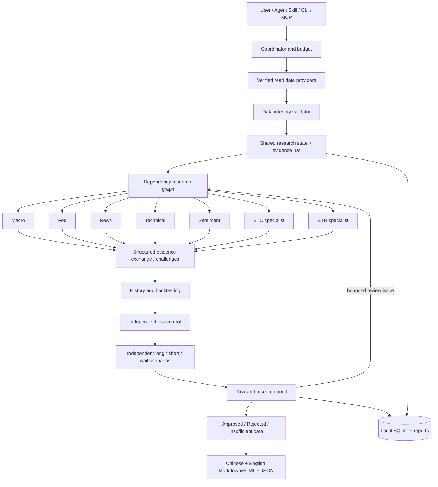

# Architecture

The local engine owns state, deterministic calculations, provenance, permissions, scheduling and persistence. Risk control consumes source and specialist results before strategy and chief review; the final report applies the committee and publication-time ticker freshness gates. Models do not control safety gates. Each result is schema validated and versioned. Evidence updates invalidate dependent results; the message/event log preserves challenges and revision reasons. Maximum rounds, requests, calls and time constrain loops.

Four execution modes share the graph: Codex CLI review (default), deterministic numerical diagnostics, real host agents with task/submit protocol, or a configured compatible LLM provider. A report labels its engine. The same model prompted with several role names is not presented as real independent host execution.

The data boundary classifies all capabilities. Research invokes only allowed READ calls with parameter validation, no shell strings, bounded retries and fixed provider routing. Trading, transfer, bot and earn WRITE operations are unavailable to the research graph. Optional MCP exposes research commands, not arbitrary process execution.

SQLite and local reports live in the per-user data directory. Installation and publication omit records, authentication files and runtime markers. Each report carries a Research ID and resolvable evidence/version references. JSON schema describes machine exchange; Markdown/HTML are views of the same record.
