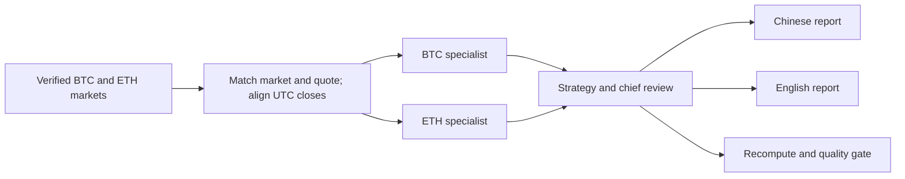

# ATLAS 0.2.0: bilingual and BTC/ETH specialist validation

**Validation date:** 2026-10-26. **Environment:** macOS arm64, Python 3.12. **Scope:** local read-only research. Archived runs are historical snapshots, not live prices at the time of reading.

## Delivered changes

| Capability | Implementation | Boundary |
|---|---|---|
| Chinese and English reports | Each completed run writes Markdown, HTML, and a market SVG in both languages; `--lang zh|en` selects the main report | Raw evidence remains in JSON. When no faithful translation exists, the English view points to the source instead of guessing. |
| BTC specialist | Computes the 30-day return spread, price-ratio change, realized volatility, and drawdown against a matching ETH market | Describes past observations only; does not infer market-cap dominance, fund flows, or win probability. |
| ETH specialist | Applies the same calculations to ETH against BTC | Spot compares with spot; USDT swaps compare with USDT swaps. Requires 31 consecutive aligned confirmed UTC daily closes. |
| Research graph | Full mode has ten roles with specialist dependencies, raw evidence, and recomputation audit | Host mode creates ten role tasks. Archived schema 1.0 records retain their original eight-role scope. |

## Executed research

| Sample | Research ID and input | Specialist state | Result |
|---|---|---|---|
| BTC spot | `atlas_854f02e37ac544e1`; `BTC-USDT`, full, `--lang en` | BTC and ETH `complete`; 89 aligned confirmed daily closes each | All ten roles; both Markdown/HTML/SVG language variants; `INSUFFICIENT_DATA`; zero critical audit issues. |
| ETH swap | `atlas_fe6e5fc7eb324d03`; `ETH-USDT-SWAP`, full, `--lang zh` | BTC and ETH `complete`; 89 aligned confirmed daily closes each | All ten roles; both Markdown/HTML/SVG language variants; `INSUFFICIENT_DATA`; zero critical audit issues. |

These are archived studies from live data sources, not successful trades or return claims. The full committee was not approved because required macro and other coverage remained incomplete. Neither English Markdown file contains Chinese ideographs; the HTML language attributes are `zh-CN` and `en`. Records live under `~/Library/Application Support/ATLAS/reports/<research ID>/`. Use `atlas history show ID` and `atlas audit ID` for provenance and integrity. The archived eight-role record `atlas_72580638202c4997` loads under the new code with its original role scope and no new missing-specialist audit issue.

## Checks run

| Check | Result |
|---|---|
| `.venv/bin/python -m pytest -q` | 88 passed, including missing-day, market/quote mismatch, numeric tampering, host tasks, bilingual artifacts, and old archive compatibility. |
| `skill-creator/scripts/quick_validate.py ABSOLUTE_PROJECT_PATH` | `Skill is valid!` |
| `.venv/bin/skills-ref validate ABSOLUTE_PROJECT_PATH` | `Valid skill` |
| `.venv/bin/python -m pip_audit -r requirements.lock` | No known vulnerabilities found; this is not a comprehensive security audit. |
| `.venv/bin/python -m build --sdist --wheel` | Version 0.2.0 source archive and wheel built successfully. |
| `.venv/bin/python scripts/validate.py --package dist/atlas-institutional-research-0.2.0.zip` | 79 public files checked and packaged; developer environments, secrets, databases, and research records excluded. |
| `scripts/install.py --with-mcp` | Updated `~/.codex/skills/atlas-institutional-research`; user research data remained untouched. |
| Installed `--version` and `doctor --network` from another directory | Version 0.2.0, MCP SDK available, public OKX ticker network check succeeded; no order writing implemented. |
| Installed Skill format checks and `atlas audit ID` for both studies | Both validators passed; both JSON report hashes intact, with zero critical issues. |

The [0.1.0 validation report](validation-report.md) retains the earlier full-study and backtest figures. This release does not establish predictive skill or improve a live trading win rate. Point-in-time full-committee replay, independent out-of-sample advantage, and actual fills remain unverified.
