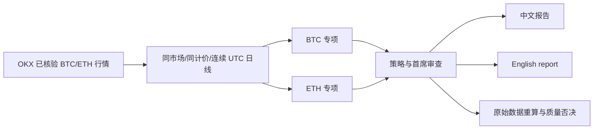

# ATLAS 0.2.0 双语与 BTC/ETH 专项验收报告

**验收日期：** 2026-10-26　**环境：** macOS arm64、Python 3.12　**研究性质：** 本地只读分析。研究记录是验收时的历史快照，不代表阅读时的实时行情。

## 本次变更

| 能力 | 已实现内容 | 证据与边界 |
|---|---|---|
| 中英文双语 | 每次完成研究同时写出中文、英文 Markdown、HTML 和语言对应的 SVG 行情图；`--lang zh|en` 选择主报告 | 两份实时样本的英文 Markdown 均无汉字；原始证据留在 JSON，缺少可靠译文时使用索引，不猜译 |
| BTC 专项研究员 | 用经核验的 BTC 市场和 ETH 同类市场，计算 30 日相对收益、价格比变化、波动及回撤 | 仅描述过去数据；不从价格推断市值占比、资金流或胜率 |
| ETH 专项研究员 | 用同一规则研究 ETH，并与 BTC 作对照 | 现货只比现货，USDT 永续只比 USDT 永续；要求 31 根连续、对齐、已确认 UTC 日线 |
| 研究委员会 | 完整模式从 8 个角色扩为 10 个，增加角色依赖、原始证据和重算审查 | 宿主模式生成 10 份独立任务；旧版 1.0 记录仍保留原八角色要求 |

## 实际运行记录

| 样本 | 运行 ID 与输入 | 专项角色 | 结果与报告 |
|---|---|---|---|
| BTC 现货 | `atlas_854f02e37ac544e1`；`BTC-USDT`，完整模式，`--lang en` | BTC、ETH 均 `complete`；各有 89 根对齐已确认日线 | 十角色齐全；中英文 Markdown/HTML 与 SVG 齐全；`INSUFFICIENT_DATA`；0 个 critical 审查问题 |
| ETH 永续 | `atlas_fe6e5fc7eb324d03`；`ETH-USDT-SWAP`，完整模式，`--lang zh` | BTC、ETH 均 `complete`；各有 89 根对齐已确认日线 | 十角色齐全；中英文 Markdown/HTML 与 SVG 齐全；`INSUFFICIENT_DATA`；0 个 critical 审查问题 |

两个样本都是**实时来源的已归档研究**，不是成功交易或收益证明。完整委员会没有获批，是因为宏观等必要数据覆盖仍不足。两份英文 Markdown 通过汉字字符扫描；HTML 分别标识 `lang="zh-CN"` 和 `lang="en"`。报告路径位于本机 `~/Library/Application Support/ATLAS/reports/<运行 ID>/`，可用 `atlas history show ID` 和 `atlas audit ID` 复查来源及完整性。原 0.1.0 八角色档案 `atlas_72580638202c4997` 用新模型读取时保留八角色要求，审计没有新增专项缺失问题。

## 检查结果

| 检查 | 结果 |
|---|---|
| `.venv/bin/python -m pytest -q` | 88 项通过；包括对齐缺口、市场与计价不匹配、数值篡改、宿主任务、双语产物、旧档案兼容 |
| `skill-creator/scripts/quick_validate.py ABSOLUTE_PROJECT_PATH` | `Skill is valid!` |
| `.venv/bin/skills-ref validate ABSOLUTE_PROJECT_PATH` | `Valid skill` |
| `.venv/bin/python -m pip_audit -r requirements.lock` | 未发现已知漏洞；不等同全面安全审计 |
| `.venv/bin/python -m build --sdist --wheel` | 0.2.0 源码包与 wheel 构建成功 |
| `.venv/bin/python scripts/validate.py --package dist/atlas-institutional-research-0.2.0.zip` | 79 个公开文件检查通过并打包；排除开发环境、密钥、数据库与研究记录 |
| `scripts/install.py --with-mcp` | 更新本机 `~/.codex/skills/atlas-institutional-research`；用户研究数据未变更 |
| 跨目录已安装版 `--version`、`doctor --network` | 0.2.0、MCP SDK 可用，公开 OKX ticker 网络测试成功；交易写入未实现 |
| 已安装 Skill 格式检查、两份报告 `atlas audit ID` | 两个格式检查通过；两份报告 JSON 哈希完整、critical 问题均为 0 |

旧版完整研究与回测图表仍见 [0.1.0 验证报告](validation-report.md)。本次扩展没有证明预测能力或提升实盘胜率；完整多角色的逐时点历史回放、独立样本外优势和真实成交仍未验证。
