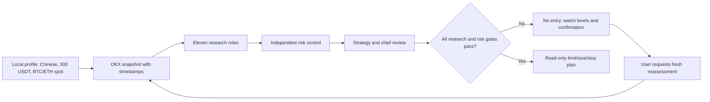

# ATLAS 0.3.0: risk control and key-level reassessment validation

**Date:** 2026-10-26. **Environment:** macOS arm64, Python 3.12. All prices below are archived observations at their UTC timestamps, not current prices when this document is read. No orders were placed and no increase in trading win rate was established.

## Delivered

| Capability | Implementation | Boundary |
|---|---|---|
| First-use setup | `atlas init` records language, USDT capital, primary instruments, and a declaration about positions/open orders in local nonsecret configuration. | Capital and exposure are user reported, not read from OKX. A no-position declaration expires for entry decisions after 24 hours. |
| Independent risk officer | The eleventh `risk_control` role runs before strategy and chief review, provides a veto, and is recomputed during audit. | Unknown exposure, stale quotes, missing rules, incomplete evidence, or unverified edge block an executable plan. |
| Final report decision | Every report ends with observed price and UTC time, daily/weekly/monthly trends, preceding 20 closed-day support/resistance, distance, entry yes/no, reasons, and confirmation conditions. | “Current” refers only to report completion; archives do not update automatically. |
| Reassessment | `atlas reassess ID` creates a new research ID and fresh data snapshot while retaining prior levels for comparison. | A user-reported touch is not treated as verified market evidence. |
| Conditional order plan | Only a fully passed gate calculates a limit price, risk-based quantity, stages, and stop reference. | Full-committee point-in-time out-of-sample edge remains unverified; the actual reports generated no executable order quantity. Stops may slip. |

## Local profile and observed market samples

The user selected **Chinese, 300 USDT, BTC-USDT and ETH-USDT spot** and stated that there were no positions or open orders at setup time. The local profile was saved. Default estimated loss budget is 0.5% per trade, or **1.50 USDT**; the notional cap is 25%, or **75 USDT**. These are planning limits, not an optimized profit rule or a guarantee against gaps and stop slippage.

| Archived sample | Quote time UTC | Observed price | Prior-20-closed-day support / resistance | Daily / weekly / monthly trend | Entry |
|---|---|---:|---:|---|---|
| BTC-USDT `atlas_0649825696964266`, actual recheck of `atlas_2132df11872a471c` | 2026-10-26 06:57:47 | 80,061.8 USDT | 79,220.1 / 86,994.3 USDT | neutral / neutral / bullish | **No.** Price was 1.06% above support and 8.66% below resistance; breakout and volume were unconfirmed, several research domains were incomplete, and the full-strategy edge was unverified. |
| ETH-USDT `atlas_f7e32ac4e7784bf2` | 2026-10-26 06:58:00 | 2,318.89 USDT | 2,282.85 / 2,737.83 USDT | bearish / neutral / bullish | **No.** Price was 1.58% above support and 18.07% below resistance; timeframes conflicted and required research/validation was incomplete. |

**Why these levels matter:** support is the lowest low and resistance the highest high of the 20 confirmed daily bars preceding the latest confirmed bar. Watch for a confirmed daily close above resistance with volume above the prior 20-day average, or a support test followed by a daily close back above it. A touch alone proves neither breakout nor reversal. When the user requests a decision at a level, run `atlas reassess ID` for new quotes, research, risk findings, and a new ID.

Both studies contain all eleven role results and both language variants of Markdown/HTML and SVG charts. The risk officer completed its assessment; final status remained `INSUFFICIENT_DATA`. English Markdown contains no Chinese ideographs. Neither report had a critical audit issue, but required evidence and research gaps still prevented entry. See the records in `~/Library/Application Support/ATLAS/reports/<research ID>/` or use `atlas history show ID`.

## Checks

| Check | Result |
|---|---|
| `.venv/bin/python -m pytest -q` | 92 passed, including setup, veto/recomputation, limit sizing, new-ID reassessment, and archived-record compatibility. |
| Live BTC reassessment | `atlas_0649825696964266` stored the prior ID/levels and generated a new data-based decision. |
| Live ETH research | `atlas_f7e32ac4e7784bf2` completed eleven roles and preserved timeframe conflict. |
| Bilingual output | Chinese and English Markdown/HTML were generated; English Markdown had no Chinese ideographs. |
| `skills-ref validate` and Skill Creator quick validation | Passed in both project and installed Skill directories. |
| `pip_audit -r requirements.lock` | No known vulnerabilities found; not a comprehensive security audit. |
| `python -m build --sdist --wheel` | Version 0.3.0 source archive and wheel built. |
| `scripts/validate.py --package dist/atlas-institutional-research-0.3.0.zip` | 83 public files checked and packaged; the ZIP excludes local configuration, credentials, research database, and reports. |
| Local upgrade and cross-directory smoke check | Installed 0.3.0 without changing user research data; complete profile, MCP SDK available, public OKX ticker network check succeeded, and order writing remains unavailable. |
| Installed audit of both research IDs | Both `report.json` hashes intact, zero critical issues; final status still `INSUFFICIENT_DATA`. |

No live trading or private account balance/position read occurred. Prior bilingual/specialist checks remain in the [0.2.0 report](validation-report-v0.2.en.md).
