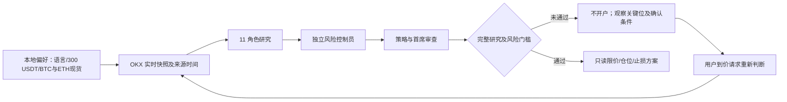

# ATLAS 0.3.0 风险控制与关键位复查验收报告

**验收日期：** 2026-10-26。**环境：** macOS arm64、Python 3.12。**事实边界：** 以下价格和判断只对应记录的 UTC 报价时间，不能当作阅读时的实时价格；没有执行订单，也没有证明提高交易胜率。

## 本次交付

| 功能 | 实际实现 | 风险边界 |
|---|---|---|
| 首次配置 | `atlas init` 收集语言、USDT 本金、主做交易对及是否有持仓/挂单；配置保存在本机用户数据目录 | 本金和持仓是用户声明，未读取 OKX 账户；无持仓声明超过 24 小时后不用于入场判断 |
| 独立风险控制员 | 第 11 个角色 `risk_control` 位于研究员之后、策略与首席审查之前，给两者提交可否决报告；审计从原始快照重算其结果 | 持仓未知、过时报价、规则缺失、证据不完整或未验证优势均阻断可执行方案 |
| 报告末尾判断 | 显示观测价格和 UTC 时间、日/周/月趋势、前 20 根已收盘日线支撑/阻力、距离、能否开仓、理由及确认方法 | “当前”只指报告完成时；已归档报告不会自动保持实时 |
| 到价复查 | `atlas reassess ID` 新建研究 ID、重新取行情，并在新报告中保留前次关键位 | 用户说“到价”不等于已经从市场数据核实触碰；每次重判以新数据为准 |
| 条件挂单方案 | 仅全部门槛通过时才计算限价、保守仓位、分段数量和止损参考 | 当前完整委员会逐时点样本外优势未验证，所以本次实际报告均没有生成可执行挂单量；止损不保证成交价 |

## 本机配置和实际市场样本

用户本次明确选择 **中文、300 USDT、本轮 BTC-USDT 与 ETH-USDT 现货**，并表示当时没有持仓或未成交挂单。`atlas init` 已保存非密钥偏好；默认单笔预估损失预算为本金的 0.5%，即 **1.50 USDT**，名义头寸上限为 25%，即 **75 USDT**。这是限制损失的规划参数，不是盈利最优参数，也不能保证跳空、滑点或止损失效时损失恰好封顶。

| 冻结样本 | 报价时间 UTC | 已观察价格 | 前 20 根已收盘日线支撑 / 阻力 | 日 / 周 / 月趋势 | 入场判断 |
|---|---|---:|---:|---|---|
| BTC-USDT `atlas_0649825696964266`（前次 `atlas_2132df11872a471c` 的实际复查） | 2026-10-26 06:57:47 | 80,061.8 USDT | 79,220.1 / 86,994.3 USDT | 中性 / 中性 / 偏多 | **否**。价格高于支撑约 1.06%，距阻力约 8.66%；日线突破和量能未确认，宏观/情绪/回测研究尚不完整，完整策略优势未验证。 |
| ETH-USDT `atlas_f7e32ac4e7784bf2` | 2026-10-26 06:58:00 | 2,318.89 USDT | 2,282.85 / 2,737.83 USDT | 偏空 / 中性 / 偏多 | **否**。价格高于支撑约 1.58%，距阻力约 18.07%；多周期冲突，日线突破未确认，必要研究和完整策略验证不足。 |

**为何看这些位置：** 支撑是最新已收盘日线之前 20 根的最低价，阻力是同一窗口的最高价。观察已收盘日线是否突破阻力且成交量高于此前 20 日均量，或测试支撑后日线重新收回。单次触价不能证明突破或反转。用户在关键位请求判断时，运行 `atlas reassess ID` 取得新报价、研究、风险报告与新 ID；不沿用本表价格。

两个样本均有 11 个角色、两种语言的 Markdown/HTML 和 SVG 图表，风险员状态为 `complete`，最终阶段为 `INSUFFICIENT_DATA`。英文 Markdown 的汉字字符扫描为零。两份报告审查没有 critical 问题，但存在必要数据或研究缺口，因此不能把 “无 critical” 理解为准许开仓。报告位于 `~/Library/Application Support/ATLAS/reports/<运行 ID>/`；可用 `atlas history show ID` 复查具体路径。

## 验证

| 检查 | 实际结果 |
|---|---|
| `.venv/bin/python -m pytest -q` | 92 项通过；含首次配置、风险否决与重算、限价分仓上限、复查新 ID、既有档案兼容 |
| BTC 真实复查 | 新 ID `atlas_0649825696964266`，记录原 ID 与前次关键位；重新取行情后输出新结论 |
| ETH 真实研究 | `atlas_f7e32ac4e7784bf2`，11 个角色齐全，保留多周期冲突 |
| 报告双语 | 中文与英文 Markdown/HTML 齐全；英文报告没有汉字字符 |
| `skills-ref validate` 与 `skill-creator` 快速校验 | 项目目录及已安装 Skill 均通过 |
| `pip_audit -r requirements.lock` | 未发现已知漏洞；不代表全面安全审计 |
| `python -m build --sdist --wheel` | 0.3.0 源码包和 wheel 构建成功 |
| `scripts/validate.py --package dist/atlas-institutional-research-0.3.0.zip` | 83 个公开文件检查通过并打包；ZIP 排除本地配置、密钥、研究数据库与报告 |
| 本机升级和跨目录检查 | 已安装 0.3.0；用户研究数据未变；配置完整、MCP SDK 可用，公开 OKX ticker 网络测试成功，交易写入未实现 |
| 已安装版本复审两个运行 ID | 两份 `report.json` 哈希完整，critical 审查问题均为 0；最终仍为 `INSUFFICIENT_DATA` |

本次没有实盘交易、没有从 OKX 账户读取余额或持仓，也没有对策略优势做出正面证明。旧版双语与专项验收记录见 [0.2.0 报告](validation-report-v0.2.md)。
