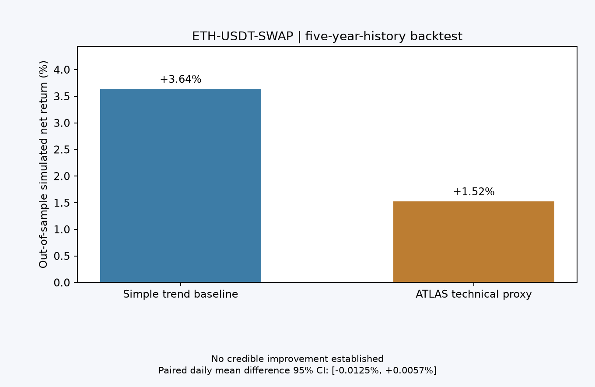
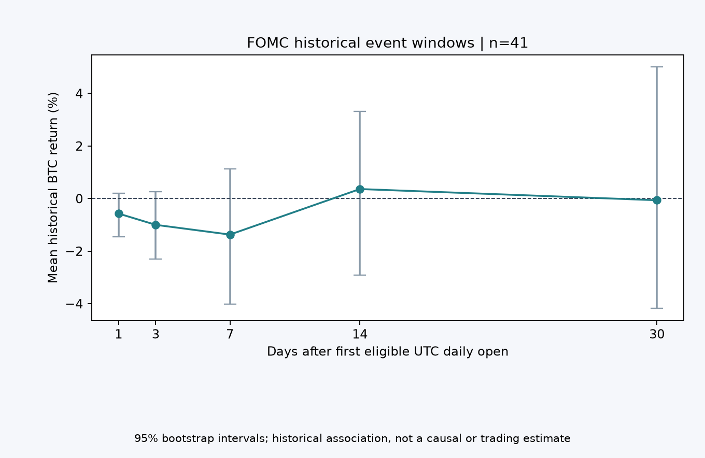

# ATLAS 验收与交易研究报告

**版本：** 0.1.0；**验收日期：** 2026-10-26；**环境：** macOS arm64、Python 3.12、Node 24.22.1；**性质：** 本地独立研究软件。以下记录的是该日的历史/冻结样本，不能代替打开报告时的实时价格。

## 一、实际交付范围

ATLAS 已实现 Codex 可发现的 `SKILL.md`、独立 Python CLI、只读 MCP 服务、八个结构化研究角色、可核验数据证据、跨角色请求与版本修订、数据质量与风险审查、SQLite 档案、Markdown/JSON/HTML 报告。研究入口会区分确定性、宿主多智能体和可选兼容模型三种执行方式；同一状态记录了实际使用的引擎。没有实盘下单功能，也没有以名称暗示官方机构认证。

| 模块 | 实际实现与验证 | 对研究的实际帮助 | 当前界限 |
|---|---|---|---|
| 官方只读数据路由 | OKX CLI、只读 MCP、公开 API；身份/能力探测、来源、时间和降级记录 | 降低来源错误与资产混淆 | 私有信息受账户权限限制；不同通道可能不可用 |
| 技术分析 | 已收盘日/周/月线指标，原始 K 线哈希与审查时重算 | 让周期矛盾和指标预热缺口显性化 | 技术形态本身没有经证实的盈利优势 |
| Fed、宏观、新闻 | 联储原文、FRED 观测、新闻去重及跨角色质询 | 避免误读政策事件或把重复报道当多条独立信息 | 历史首发版本、市场预期、部分宏观序列仍缺 |
| 情绪与衍生品 | 资金费率、OI、情绪样本与 smart-money 口径并列 | 发现拥挤、口径不一致和反证 | 单点持仓无法确定拥挤或未来方向 |
| 策略与风控 | 多头、空头、等待条件；完整数据/版本审查可否决 | 将条件、失效点和暂停理由留档 | 情景是研究，不是委托交易指令 |
| 历史验证 | 次根开盘、成本、样本外、滚动与 bootstrap 置信区间 | 量化否定缺乏优势的候选规则 | 仅技术代理规则；完整多角色历史重演尚未实现 |
| 审计与复盘 | 角色版本、不可替换证据、回溯、报告哈希与后验观察 | 支持发现漂移、修订与错误归因 | 后验观察不等于实盘成交或策略胜率 |

## 二、真实运行记录

| 验证 | 可复查记录 | 结果 |
|---|---|---|
| 自动测试 | `pytest -q` | 82 项测试通过（见最后一次验收命令）；包括指标、回测、数据路由、审查、版本、MCP 协议与安装边界 |
| 依赖安全 | `pip_audit -r requirements.lock`，另审计已安装的含 MCP SDK 运行环境依赖清单 | 两次检查均未发现已知漏洞；不是全面安全审计 |
| 构建 | `python -m build --sdist --wheel` | 源码包与 wheel 均构建成功 |
| 官方 OKX MCP | `@okx_ai/okx-trade-mcp@latest --modules market,news,smartmoney --read-only` | 服务发现成功；`market_get_ticker` 返回 ETH-USDT 行情；双层数据封装已解开 |
| 实际用户安装 | `scripts/install.py --with-mcp` | 已安装于 `~/.codex/skills/atlas-institutional-research`，独立运行环境位于用户 ATLAS 数据目录；跨目录 `doctor`、格式检查及已安装 MCP 五工具发现成功 |
| 完整实时数据研究 | `atlas_82bbf24956c34c79` | 八角色确定性研究，最终 `INSUFFICIENT_DATA`；原因含必要宏观缺口、技术代理边界；没有交易 |
| 独立宿主协作 | `atlas_72580638202c4997` | 八个角色实际提交、版本复核与首席审查；最终 `INSUFFICIENT_DATA`，未批准当前入场 |
| 五年历史回测 | `atlas_7460e26e61734b6e` | ETH-USDT-SWAP 完整日线覆盖；代理策略未显现可信改进 |
| FOMC 事件研究 | `atlas_950943bc35724fb3` | BTC-USDT，联储公告原文明确发布时间，41 个可用事件、6 个不合格事件拒收 |

### 回测：候选技术代理未跑赢简单基线

五年历史日线约 1827 根，时间顺序训练/样本外划分，预先规定交易费、滑点、价差和风险参数；资金费率历史缺失。表中是 **样本外模拟结果**，不是实盘收益。完整委员会的历史宏观、新闻与情绪特征不能从当下快照重建，因此 `ATLAS technical proxy` 只代表预设技术规则。

| 指标 | 简单趋势基线 | ATLAS 技术代理 |
|---|---:|---:|
| 样本外交易数 | 41 | 49 |
| 样本外净收益 | +3.636% | +1.523% |
| 模拟胜率 | 41.46% | 36.73% |
| 最大回撤 | 2.483% | 1.877% |
| 盈亏因子 | 1.350 | 1.224 |

样本外配对**日均收益差**的 95% moving-block bootstrap 区间为 **−0.01245% 至 +0.00566%**（731 个样本外日收益）。区间跨零；所比较规则不能证明胜率或收益改进。两个净收益也不能与“交易胜率”混用。回测尚未覆盖持续资金费、真实挂单成交、强平、市场冲击及完整多角色历史决策。

### FOMC：发布时间核验后才入样

FOMC 研究从[联储官方公告](https://www.federalreserve.gov/monetarypolicy/fomccalendars.htm)逐条提取印出的发布时间和 EST/EDT，使用首次合格 UTC 日线开盘作观测锚点。41 个事件满足时点与行情要求，6 个被拒收。1、3、7、14、30 天平均收益约为 −0.57%、−1.00%、−1.37%、+0.36%、−0.06%；各窗口 95% 区间均跨零。它是多种事件和市场环境混合后的历史相关性，不是 FOMC 的因果效应，也不是开仓方向预测。CPI 官方归档在本环境返回 403，因此未伪造 CPI 样本。

## 三、实际宿主多智能体案例

ETH-USDT-SWAP 的宿主研究从 OKX、Fed、FRED、新闻等冻结快照出发。Fed 研究员由原文修正了 2026 年 9 月政策事件：当时为加息 25bp 至 3.75%–4.00%，后续演讲仍是条件表述。技术研究员复核后保持原 OHLCV 计算，不把政策新事实编造成技术信号变化。新闻研究员将重复叙事归类，并保留链上信息缺少独立交易哈希的限制。宏观研究员明确 FRED 最新修订值不能当历史首发值。情绪研究员记录略偏空的提及样本与略净多的选定 smart-money 样本，两者口径不同，无法确认拥挤方向。回测研究员复算当前冻结的 299 根日线代理比较：样本外代理 −0.5588%（6 笔），基线 +0.3686%（7 笔），区间跨零；299 根不能替代五年完整样本。

首席审查提交后，完整宿主研究有八个角色结果、23 条跨角色消息、98 个证据记录及各自的版本历史。最终状态是 **`INSUFFICIENT_DATA`**、`approved=false`、报告哈希完整。实际审查拦下过时报价、八个仍属部分完成的角色结论和缺失宏观覆盖；日/周/月结构冲突仍被显式保留。宿主自行核验的官方原文记录有哈希与来源，但引擎没有对所有 `host_attested` 网页逐项自动重抓，因此保留来源复核告警。**没有批准当前多头或空头入场，也没有执行订单。**

## 四、最可能真正有用的下一版 Skill 工作

以下按**降低误判、可测量性和投入顺序**排列。“提升胜率”是待检验假设；必须在预先固定的策略、独立样本外数据和真实摩擦下检验，不能靠增加指标数量宣称成功。

| 优先级 | 拟开发能力 | 为什么可能有帮助 | 必须满足的验收指标 |
|---|---|---|---|
| P0 | 历史时点数据库：政策预期、新闻首发、宏观 vintage、衍生品历史 | 避免未来数据泄漏，才能重放完整多角色决策 | 每条数据有首发时间、可用时间、原始来源；回放不得读取之后的修订 |
| P0 | 暂停与数据否决规则 | 缺数据、过时报价和口径冲突时减少无依据交易 | 反例集全部拒绝；无绕过入口；拒绝原因可审计 |
| P1 | 可复现的纸面交易追踪 | 将“研究正确”与“可成交获利”分开 | 逐笔模拟订单、资金费、滑点与未成交；记录所有机会含未下单情形 |
| P1 | 预注册基线与滚动样本外评估 | 防止挑选有利币种、区间和参数 | 时间顺序回放；与简单基线同成本同风险；效应区间与多重比较修正 |
| P2 | 策略失效监控与漂移告警 | 长期检测规则不再适用 | 事先写阈值与停用条件，记录误报、漏报与人工复核 |
| P2 | 保守的仓位/损失预算建议 | 改善风险暴露控制 | 仅模拟或研究范围；按账户约束、最坏成交与相关性测算，用户另行决定交易 |

只有在 P0 数据补齐后，才可能有意义地检验“多角色是否比简单基线更好”；目前既没有证明优势，也没有真实交易胜率。最直接可用的价值是：**把缺证据、过时数据、周期冲突和不可信回测及时暴露出来**。

## 五、可复查与尚未验证项

项目命令：`python scripts/validate.py`、`skills-ref validate "$PWD"`、`python -m pytest -q`、`python -m pip_audit -r requirements.lock`、`python -m build`。图表由 `python scripts/plot_validation.py` 从 [冻结摘要](examples/validation-summary.json) 生成，需可选 `matplotlib`。运行时原始数据、角色结果和源链接在默认数据目录 `~/Library/Application Support/ATLAS/reports/RESEARCH_ID`，用户可用 `atlas history show ID`、`atlas audit ID`、`atlas export ID` 检查。

本机已验证 macOS/Codex、CLI 和 MCP 协议；Windows、Linux、Claude Code、Cursor、OpenClaw 以及对外平台审核尚未实际运行。兼容格式只是预备，不能称为这些客户端或 OKX Marketplace 已认证。可选付费 LLM 仅做结构化 mock 测试，未用真实付费模型形成上述研究。发布前还需人工复核数据许可、品牌与平台清单；本次没有上传 GitHub 或提交 OKX 审核。
